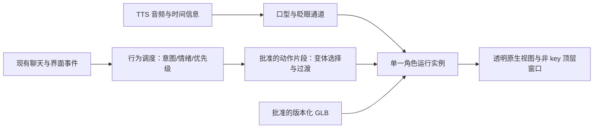

# AI 数字人接入方案与验收后重构（2026-10-14）

> 当前方案已更新：用户取消人形制作，已按确认的 Demo 接入动态光球。本文保留为人形方案历史；现行实现与验收状态见 [光球接入记录](assistant-light-orb-20261014.md)。

状态：用户已要求开始修改；Filament 原生预览已接入 Debug；角色动作效果未通过验收，未执行项目清理。用户要求先检查角色没有问题，再重构与清理，此顺序是执行门槛。

## 推荐结论

采用“游戏标准角色制作 + 端上轻量 3D 渲染 + 独立行为与聊天控制”。保留 Hunyuan3D 角色的外观、服装与材质参考，重做适合动作的拓扑、绑定、表情与动画。端上优先验证 Filament / Metal；验证合格后取代当前 SceneKit 角色渲染。Swift、UIKit、SnapKit、现有聊天与业务接口保持现行合同。

Filament 1.78.0 已通过透明渲染、成熟样例骨骼动画、morph 和 APP 叠层的最小样机验证。当前选定 Hunyuan 模型只通过静态材质与部分表情预览，模型自身仍无合格身体片段；真机能耗与正式包体尚未测量。不能把完整 APP 迁入游戏引擎，或者把当前会变形的资产换个引擎加载后就宣布解决。

当前优化目标：右下角透明常驻、覆盖 APP 自己的页面与弹窗、动作可切换和自然过渡、表情可混合、聊天可打断、iOS 15 兼容、包体与运行开销可控。“最上层”只指本 APP 的窗口，不覆盖 iOS 系统授权界面、锁屏或其他 APP。

## 已核实的问题

- 当前 Hunyuan3D 运行资产为 85,000 三角面、18 根骨骼、10 个表情通道，资产内没有动画片段，动作由 APP 临时计算关节角度。
- 权重归一化、骨骼名称和加载测试通过，仍不证明动作不会拉伸。额外 CPU 蒙皮诊断在旧资产的最大挥手采样上发现可见网格边最大约 12.38 倍拉伸；捂面约 20.52 倍。它只检查指定姿态和边长度，不等于完整碰撞或观感验收。
- 刚体分片避免边拉长却出现可见裂口；包络与局部骨骼链试验仍有拉伸。最新闭合身体候选的骨骼热绑定明确报告求解失败，7,400 个身体顶点权重质量全部为零；旧检查把未归一化权重与无权重混同，已经修正这项判断。以上试验全部拒绝，APP 已恢复原运行资产，未把失败试验称为正式版本。
- 游戏引擎负责显示、动画过渡、材质和运行管理。可形变拓扑、解剖关节、服装蒙皮、脸部结构与动作本身仍需制作。现有自动补骨骼方式不能作为商业角色资产交付标准。

证据存于 `assistant-character-concepts-20261012/cooking-fairy-runtime/validation-controls-20261014/`。历史 13 项测试通过的范围是加载、表情位移、部分渲染与任务生命周期；角色验收状态已改为未通过。

## 引擎选型

| 方案 | 已核实能力与限制 | 本项目判断 |
| --- | --- | --- |
| Unity as a Library | 官方 iOS 常规嵌入只支持全屏，单 runtime；unload 后仍保留内存，完全 quit 后同一进程不能重新加载。非游戏商业用途还有许可证分类边界。 | 适合作为独立角色制作/验收工具或未来全屏体验候选；当前不直接嵌入右下角常驻小窗。 |
| Filament / Metal | 官方有 iOS 透明 UIView 示例；支持 GLB/glTF 蒙皮、morph 与动画 crossfade。官方 1.78.0 XCFramework 已通过本地 SPM 接入并构建；C++ 桥接与透明小窗已有模拟器证据，正式体积与真机开销仍待测。 | 当前 iOS 15、透明小窗与标准 GLB 的优先验证路线；使用成熟渲染/加载机制，只写业务调度和薄桥接。 |
| RealityKit | Apple 推荐的长期原生方向；本机 SDK 中 `BlendShapeWeightsComponent` 从 iOS 18 起可用。 | 若调整系统支持范围，或旧系统采用脸部骨骼方案，可再比较。透明背景、小窗与完整表情需要先证明，不直接承诺。 |
| 现有 SceneKit | 已接入，原生小窗方便；Apple 已宣布进入维护阶段，现有 APP 仍可运行。 | 留作过渡和回滚，不再继续扩张大量手写骨骼补丁。 |
| Godot / SwiftGodotKit | 维护者项目提供 Swift 嵌入和 SPM；当前资料基于定制 libgodot 分支/payload。 | 是候选，需额外验证稳定性、生命周期、透明小窗与维护成本，不因开源就默认采用。 |

官方来源：[Unity 嵌入限制](https://docs.unity3d.com/6000.0/Documentation/Manual/UnityasaLibrary.html)、[Unity 用途分类](https://unity.com/legal/editor-terms-of-service/software/faq)、[Filament iOS 示例](https://github.com/google/filament/blob/main/ios/samples/README.md)、[透明 UIView 实现](https://github.com/google/filament/blob/main/ios/samples/transparent-rendering/transparent-rendering/FilamentView.mm)、[动画过渡接口](https://github.com/google/filament/blob/main/libs/gltfio/include/gltfio/Animator.h)、[Apple 迁移说明](https://developer.apple.com/videos/play/wwdc2025/288/)、[表情权重组件](https://developer.apple.com/documentation/realitykit/blendshapeweightscomponent)、[SwiftGodotKit 维护者仓库](https://github.com/migueldeicaza/SwiftGodotKit)。

Filament 仓库采用 [Apache 2.0](https://github.com/google/filament/blob/main/LICENSE)，README 明确它并非 Google 提供正式产品支持的服务。引入时还需核查选定发行版的传递依赖和角色/动画素材许可证。当前查得发行版为 [v1.78.0](https://github.com/google/filament/releases/tag/v1.78.0)，含材质版本和 API 变化；样机应锁定经过验证的版本，材质编译工具与运行库同版本，不能跟随 main 自动更新。

## 角色资产制作合同

Hunyuan3D 输出用作外观和纹理来源。需要在 Blender 等制作工具中完成可编辑的游戏角色母版，而不是继续仅对高密度静态表面追加骨骼。

| 必备交付 | 具体要求 |
| --- | --- |
| 可形变网格 | 肩、肘、腕、膝与脸部有适合弯曲的拓扑；不能靠断开网格掩盖拉伸；与表情 target 拓扑一致。 |
| 身体与手部骨骼 | 固定 bind pose、单位、轴向与关节命名；有动作所需的手指/手掌控制；短身大头角色按自身比例制作动作，不能直接套普通成人动画。 |
| 服装与附件 | 袖口、裙摆、围裙和蝴蝶结正确归属；胸牌挂在胸部 socket；必要关节用 corrective shape 修正体积。 |
| 面部 | 眼球/眼睑、眉、嘴和下颌可控；情绪与眨眼左右独立；笑、难过、愤怒、害羞等在最终显示尺寸有可读变化。不能把纹理压扁当作完整闭眼。 |
| 材质 | 基础色、法线和粗糙度按正确色彩空间验证；以中性光照核对原形象，保留风格一致的着色方案；避免多套互相覆盖的运行材质。 |
| 动画库 | 动作制作并烘焙为真实片段，带名称、时长、循环、可打断点和适用场景。提供连续过渡验收，不只看单帧。 |
| 运行包 | 一个经批准的 GLB + manifest；版本、hash、骨骼、表情、动作定义同源。母版、试验资产与预览不放进 APP 资源包。 |

母版拓扑、权重与动作可能需要专业角色绑定/动画制作。自动工具可以协助，不能替代实际变形验收；这里不承诺现有网格可以无人工处理地自动修好。

建议从少量高质量片段开始：待机/呼吸、关注/聆听、招呼、思考、说明/指示、肯定、摇头、开心、低落/捂面、害羞/犹豫、愤怒/跺脚、恢复。每族逐步扩充兼容变体。不是无限随机旋转骨骼，也不是把一句话绑到一个固定姿势。

## 运行与 AI 驱动

角色行为分为基础待机、身体动作、情绪、眨眼/视线、口型。调度器根据场景选择动作族，按权重挑选已验收变体，避免连续重复；只在通过验证的范围内改变播放速度、停顿和视线。身体 clip 的交叉淡入淡出复用引擎；不能同时让多个控制器写同一关节。独立面部通道须与身体动画的导出写入范围相容。

用户手动选择动作时立即预览，表情可单独保持；“恢复自动”清除手动控制。按钮列表来自资产 manifest，避免代码中的动作枚举与资产真实内容不一致。

聊天中的“思考、回复、打断、结束”使用状态事件。后续语义情绪可来自经校验的 AI 输出，但模型只能选择允许的动作/情绪，不能直接输出任意骨骼角度。现有文字短语匹配不是完整语义理解；不提前创建未来公共接口。

口型使用 TTS 可提供的音素/viseme 时间数据；如果选定 TTS 没有这种能力，只能做明确标注的简化音频驱动，不能声称精准口型。新回复、打断和退出用 generation/epoch 丢弃旧音频与旧动作。后台停止渲染和音频，返回后恢复当前状态。

整个 scene 只维护一个角色渲染实例。窗口不抢 key，空白区域穿透，键盘出现时避让；常驻角色覆盖本 APP 的导航页面与自有弹窗。低电量/减弱动态按系统偏好降低频率或停止非必要循环。

若后续实现个人照片生成专属 IP 和实时通话，使用独立生成与媒体适配层，固化 `avatarId + assetVersion`，不把生成、会话、业务请求混在渲染器里。此前 v2 实时通话方案作为另一个待验收阶段；本方案先解决当前固定 3D 角色，没有上传照片或购买云服务。

## 样机与用户验收顺序

1. **嵌入可行性**：用成熟样例资产先证明透明小窗、现有 UIKit 叠层、表情、动画、打断和后台释放。用于技术验收，不替换用户选定形象。Filament 通过固定 XCFramework 与 SPM 管理，若不可行先回报证据；不引入 CocoaPods 或新 WebView 路线。
2. **角色资产验收**：同一 Hunyuan 外观重建后的母版，播放挥手、捂面、跺脚及对应表情；同时查看袖口、腋下、手指、裙摆和胸牌。先证明角色自身正常，再接 AI。
3. **产品场景验收**：右下角实际尺寸、页面/弹窗叠层、键盘、连续动作切换、对话打断、后台/前台、缺资源与加载失败回退；菜单覆盖资产全部动作与表情。
4. **用户确认角色效果没有问题后**：锁定一个正式资产版本，然后执行下面的模块重构和物料清理。每阶段保留可回退提交/快照，不在未验收资产上清空旧回退。

性能建议目标是待机 15–30 fps、动作 30 fps，实际按真机能耗与视觉效果选择。这是拟定目标，非测量结果。APP 体积、峰值内存、首帧耗时与帧时间均须对同一 Release 设备构建前后比较；目前没有正式包数据，不承诺一个减重百分比。

## 本次有限体积盘点

口径：2026-10-14，角色资源为源文件逻辑体积；资料与构建目录为磁盘占用近似。不是 App Store 下载大小。没有扫描全项目历史或依赖树。

| 项目 | 当前体积 | 判断 |
| --- | ---: | --- |
| cooking-fairy-mobile USDZ dataset | 17.48 MiB | 当前主资源，仍有动作问题；新版本验收前保留。 |
| 基础色 dataset | 5.30 MiB | 当前渲染明确使用。 |
| 法线 + 金属粗糙度 datasets | 4.80 MiB | 当前主渲染未读取；可考虑从 APP 移出，母版保留。不能代表将来 PBR 路径不需要它们。 |
| 旧 SCN dataset | 0.05 MiB | 当前显式回退路径，不能只按“旧”删除。 |
| mascot 图片 | 1.31 MiB | 当前 assistant 路径未见调用，测试仍有引用；清理候选，需查全体动态引用与资源包。 |
| 胸牌图片 | 0.27 MiB | 当前使用，保留。 |
| 上述角色资源合计 | 29.22 MiB | 源资源体积；编译、压缩与设备切片后的贡献未测。 |
| 概念/验收资料目录 | 约 90.15 MiB | 位于 docs，现有项目资源范围不包含它；影响工作区，不等于 APP 包体。 |
| 当前 assistant DerivedData | 约 2.40 GiB | 增量编译缓存，不装入 APP；后续按所有权和重建需要清理，避免为省空间反复全量重建。 |

源资产目录另有高精度母版、减面输入和多个试验输出。它们位于 `协作流程/角色资产/`，没有装入当前 APP 的证据；应归档和减少重复副本，而不是混同为 APP 肥大原因。母版和授权来源不删除。

## 验收后重构边界

当前 `QFDigitalAssistant.swift` 约 2,013 行，同时承担窗口、选择面板、聊天、照片/语音、本地建议、记忆、通知与渲染。这是职责耦合的证据，不是其中每段都无用的证据。

计划在角色版本锁定后按职责拆分，保持行为和业务接口不变：

| 模块 | 职责 |
| --- | --- |
| AssistantOverlay | 顶层窗口、角色入口、菜单、键盘与生命周期 |
| AvatarRenderer | GLB 加载、材质、引擎资源、渲染启停和释放 |
| AvatarBehaviorController | 状态、动作变体、优先级、过渡、打断和手动控制 |
| AvatarExpressionController | 情绪、眨眼、视线和口型；与身体动画的写入边界 |
| AssistantConversation | 现有聊天 UI、消息、请求取消与 generation |
| AssistantMedia / Memory / Nudges | 复用既有照片、语音、偏好与通知业务；不跟着渲染器重写 |
| AvatarAssets | 单一 manifest 与经批准运行包；制作/调试材料位于应用资源目录之外 |

清理按“资源引用、构建输入、实际运行与回退”建立清单，再移除确认不用的文件、代码分支和依赖；不能仅靠一次字符串搜索认定死代码。先移出 target/调用路径并完成定向验证，再归档或删除重复试验副本。清理失败可恢复正式包与一份必要回退，不永久维护三套角色实现。

全项目重构分模块小批次推进，先 assistant，再按相同证据法检查其他模块。不会重写已确认页面层级、登录/会话、三端业务接口，也不未经页面合同确认开发新页面。每批记录变更文件、删除依据、验证结果和同口径体积变化。

## 当前交付状态与资源

Filament 1.78.0 通过官方发行包 SHA-256 校验后，以本地 SPM 二进制包接入；没有引入 CocoaPods 或编译整个引擎。Debug 的“新版角色预览”可切换原生透明渲染，停用的渲染器会释放。Hunyuan 的 Z-up 源文件在预览打包时整体转为 Y-up，不分别修改关节坐标；胸牌作为现有 chest locator 的子对象。

第一轮 5 项原生渲染检查和 2 项 APP 叠层 UI 检查均通过，证据见 `assistant-character-concepts-20261012/filament-preview-20261014/validation.json`。它证明真实 GPU 输出、样例骨骼动画/切换、morph、透明背景、释放，以及角色入口在登录页面上仍可操作。没有据此宣称 Hunyuan 动作、闭眼、完整口型、所有弹窗/键盘或真机性能通过。

后续静态审查修正了暂停动作时钟、释放手动 morph 的接口、表情层的通道所有权、未运行状态的手动操作和预览初始待机选择；新增检查断言等待定向重跑。

测得当前 Debug 模拟器 APP 逻辑体积 152.38 MiB，其中预览 GLB 为 38.70 MiB；先前 Debug 包约 108.04 MiB。差额含不同构建内容，只作粗略开发参考，不作为 SDK 的 Release 贡献。SDK 开发源二进制 31.03 MiB、头文件 1.79 MiB。Release 不打包该试验 GLB。

游戏角色候选在独立目录制作，母版/当前资产未被覆盖。已修正自动制作脚本的原始权重检查，并记录 QuadriFlow 拒绝的官方数值阈值原因；分离 128 个连通片段后，6,978 顶点的主体骨骼热绑定成功，原始权重非零并正确归一化；422 个零散附件顶点按骨骼归属单独挂载。已导出 10 个片段，但严格边拉伸检查只有 calm/sad 合格，其余片段仍拒绝开放。QuadriFlow 数值尺度修正候选在 240 秒超时后停止，未进入 APP。下一步检查真实 GPU 动作外观。动作与闭眼按钮在资产尚未合格时保持不可用，避免把失败试验开放给用户。

没有创建浏览器、云账号或付费服务。Blender 制作和 Xcode 检查按整机资源规则串行；SDK、源母版、证据和增量构建目录保留以便复核。测试设备与进程状态以最后一次验证记录为准，不能终止其他项目使用的设备或构建。角色验收之前不清理项目物料。
